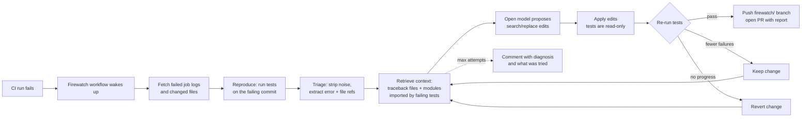

# Firewatch

**An always-on agent that turns a red CI run into a verified fix, using open models.**

When your CI fails, Firewatch wakes up, reproduces the failure, finds the code that caused it, asks an open model for a minimal patch, and **re-runs your tests to prove the patch works** before anyone sees it. If the tests pass, you get a pull request with the root cause, the diff, and the attempt history. If they don't, you get a comment explaining what it found and what it tried, and your branch is left untouched.

Built for [Openfire](https://luma.com) by Alan AI · Python · MIT licensed

---

## The problem

Coding agents made writing code fast. Fixing a broken build is still slow: someone notices the red X, opens the logs, scrolls past hundreds of lines of setup noise, finds the assertion, opens three files, works out which one is wrong, patches it, pushes, and waits for CI again.

Most "AI fixes your CI" tools stop at a suggestion. A suggestion you still have to verify is a second job. Firewatch's rule is that **nothing reaches a human until the tests pass on the patched code**.

## How it works



1. **Trigger.** A `workflow_run` workflow fires when your `CI` workflow concludes with `failure`.
2. **Reproduce.** It checks out the exact failing commit and runs your test command. If the failure doesn't reproduce, it reports "likely flaky" with a diagnosis from the CI logs instead of guessing at a fix.
3. **Triage.** GitHub log timestamps and ANSI codes are stripped, the pytest failure section is extracted, and every `file:line` reference is mapped back to a path in your repo (runner paths like `/home/runner/work/...` are normalized).
4. **Retrieve.** Open models break down when you paste a whole repository into the prompt. Firewatch builds a ranked context: files in the traceback first, then the modules that the failing test **imports** (found by parsing the test's AST, following imports two levels deep), then files changed in the failing commit. Large files are windowed around the referenced lines.
5. **Fix.** The model returns JSON with a diagnosis and `search/replace` edits.
6. **Verify.** Edits are applied and the tests are re-run. Pass → done. Fewer failures → the change is kept and the loop continues from the new state. No progress → the change is reverted, and the failed diff plus the new test output go into the next prompt so the model doesn't repeat itself.
7. **Report.** A pull request into the failing branch (and a comment on the original PR), or a diagnosis comment if no verified fix was found.

## Design decisions

These are the choices that made the difference between a demo and something I'd actually install.

**Verify inside the runner, not by pushing and waiting.** The obvious design is push a fix branch → wait for CI → read the result → retry. Each loop costs minutes, and CI on a pull request opened by the Actions bot waits for a maintainer to approve it, so there is nobody to wait for. Firewatch runs the test command itself on the checked-out commit, so each attempt takes seconds, and the PR only exists once the fix is proven.

**Search/replace edits instead of unified diffs.** Smaller open models are bad at producing valid diff hunks (line numbers drift, context lines get paraphrased). Copying an exact block of existing code is much easier for them. The patcher is forgiving where it's safe to be: it accepts a match that differs only in trailing whitespace, and re-indents a block the model returned with the wrong indentation. It refuses where it isn't safe: if a block matches in two places, the edit is rejected and the model is told to include more context.

**Tests are read-only by default.** The easiest way for a model to "fix" a failing test is to change the assertion. Edits to test files are rejected and the rejection is fed back to the model. You can opt in with `FIREWATCH_ALLOW_TEST_EDITS=true` for repos where tests are genuinely wrong.

**Keep partial progress.** If a patch takes the failures from 3 to 1, throwing it away wastes the work. Changes that strictly reduce the failure count are kept, and the next attempt starts from there. Changes that don't help are reverted byte for byte (line endings included, so it's safe on Windows checkouts).

**Interchangeable providers with fallback.** Any OpenAI-compatible endpoint works: Ollama locally, or a hosted open-model provider in CI. `FIREWATCH_PROVIDERS=ollama,remote` tries them in order, so if the local model isn't running, it falls back to the hosted one. There are no SDK dependencies; the only runtime dependency is `python-dotenv`.

**Talk to Ollama natively.** Ollama's OpenAI-compatible endpoint runs with a small default context window and silently drops the start of long prompts, which is where the instructions are. Firewatch calls Ollama's native `/api/chat` instead, with an explicit `num_ctx` (16k by default) and JSON mode, so a 7B model gets the whole prompt and can only answer in parseable JSON.

**Safe by default in CI.**
- Runs from forks are skipped, because checking out untrusted code in a job that holds a write token is a known Actions attack.
- Failures on `firewatch/*` branches are ignored, so it can't loop on its own output.
- Only the files Firewatch changed are committed, never stray artifacts.
- Paths are validated so the model can't write outside the repository or into `.git`.

## Benchmark

A fix rate measured against nothing tells you nothing, so Firewatch ships with a benchmark of 17 seeded bugs across `bench/cases` (Python/pytest) and `bench/cases-java` (Java 17/Maven). Each one is a small realistic module with a test suite, and each bug category is one I've seen break real CI:

| Category | Cases |
|---|---|
| Off-by-one | pagination start index, retry loop that stops one attempt short |
| Boundary condition | `>` vs `>=` on a discount threshold, weekday check that misses Saturday |
| None handling | name formatting with a missing middle name |
| Import error | helper renamed in one module, old name still imported in another |
| Shared state | mutable default argument, function that mutates its input |
| Arithmetic | floor division in a mean |
| Wrong key | config key renamed |
| Sort order | leaderboard sorted ascending, with a tie-break that `reverse=True` would break |
| Exception contract | bare `Exception` where callers expect `ValueError` (two locations) |
| Formatting | one decimal place instead of two |
| Cross-file contract | tax module returns percentages, checkout treats them as fractions; the test pins the tax module's contract, so the fix must go in the other file |

The three Java cases use JUnit 5 and a standard Maven layout. They cover an off-by-one loop bound, a shipping threshold where `>` should be `>=`, and a missing null guard that throws a `NullPointerException`. The runner picks `mvn -q test` automatically when a case contains a `pom.xml`, or uses an explicit `test_command` from `case.json`. Java cases need a JDK 17+ and Maven on `PATH`; run only the Python suite with `--cases bench/cases`.

`firewatch bench --validate` checks that every case in both suites fails before and passes with its reference fix. The reference fixes live in `case.json`, which is never copied into the workspace the model sees.

### Results

v1 and v2 use **qwen2.5-coder 7B through Ollama on a Windows laptop**; the last row uses **gpt-oss-120b on Groq**, the same model the GitHub Action runs with. 3 attempts per case. Raw results, including every diagnosis and diff, are in [`bench/results`](bench/results).

| | Python (14 cases) | Java (3 cases) | Total |
|---|---|---|---|
| v1: count-based progress, fixed temperature | 7/14 (50%) | not run | 7/14 |
| v2: set-based progress, escalating retries | **9/14 (64%)** | **2/3** | **11/17 (65%)** |
| v2 with gpt-oss-120b (Groq) | **14/14** | **3/3** | **17/17**, all on the first attempt |

| Case | v1 (7B) | v2 (7B) | v2 (120B) |
|---|---|---|---|
| config_wrong_key | fixed (1) | fixed (1) | fixed (1) |
| discount_threshold | not fixed | not fixed | fixed (1) |
| invoice_decimal_places | fixed (1) | fixed (1) | fixed (1) |
| leaderboard_order | not fixed | not fixed | fixed (1) |
| mean_integer_division | fixed (1) | fixed (1) | fixed (1) |
| missing_middle_name | not fixed | not fixed | fixed (1) |
| mutable_default_cart | fixed (1) | fixed (1) | fixed (1) |
| pagination_off_by_one | fixed (1) | fixed (1) | fixed (1) |
| port_exception_type | fixed (1) | fixed (1) | fixed (1) |
| renamed_import | fixed (1) | fixed (1) | fixed (1) |
| restock_mutates_input | not fixed | **fixed (2)** | fixed (1) |
| retry_attempt_count | not fixed | **fixed (1)** | fixed (1) |
| tax_rate_units | not fixed | not fixed | fixed (1) |
| weekend_check | not fixed | not fixed | fixed (1) |
| batch_loop_off_by_one (Java) | | fixed (1) | fixed (1) |
| free_shipping_boundary (Java) | | not fixed | fixed (1) |
| missing_middle_null (Java) | | fixed (2) | fixed (1) |

Numbers in brackets are the attempt that produced the passing fix.

### What the first run taught me

v1 scored 7/14. Reading the failures, not just the score, showed two problems with the agent rather than the model:

1. **Counting failures is the wrong progress signal.** On `tax_rate_units`, the model changed the tax rates from percentages to fractions. That made the two checkout tests pass and broke `test_tax`, which had been passing. Failures went from 2 to 1, so v1 kept the change as "partial progress". v2 compares the *set* of failing tests and keeps a change only if every test failing afterwards was already failing before. In the v2 run this check rejected five attempts that would otherwise have looked like progress.
2. **Retries repeated themselves.** On three failed cases, the model gave the same diagnosis on all three attempts, because at temperature 0.2 it confidently writes the same answer again. v2 raises the temperature on each retry (0.2 → 0.5 → 0.8), tells the model its previous diagnosis was probably wrong, and asks it to compare the expected and actual values. `retry_attempt_count` and `restock_mutates_input` went from not fixed to fixed.

The test-file lock also earned its place: in v1, the model's answer to `retry_attempt_count` was to edit the test so it would expect the buggy behaviour, twice. Both edits were refused.

### Honest caveats

- With gpt-oss-120b the benchmark saturates at 17/17, so it can no longer tell strong models apart. It is most useful for small models, where the agent's design visibly changes the result; separating large models needs harder, multi-file cases.
- A 7B model on a laptop is a floor, not a ceiling. Each model call takes 1–3 minutes, and runs vary: `tax_rate_units` was fixed in an earlier 3-case run and not fixed in either full run.
- Each configuration was run once, so a difference of one or two cases is within run-to-run noise. v2 not losing any case v1 fixed, while fixing two more, is the meaningful part.
- The cases are small. They measure whether the loop (reproduce, retrieve, patch, verify) works with a small open model, not how it does on a large codebase.

## Quick start

### Run locally against any repo

```bash
git clone https://github.com/ManiraM-1/firewatch
cd firewatch
python -m venv .venv
.venv\Scripts\activate          # Windows
source .venv/bin/activate       # macOS / Linux
pip install -e ".[dev]"
copy .env.example .env          # Windows  (cp on macOS / Linux)
```

Pull a coding model with [Ollama](https://ollama.com) (`ollama pull qwen2.5-coder:7b`), or fill in `LLM_BASE_URL`, `LLM_API_KEY` and `LLM_MODEL` for a hosted provider. Then:

```bash
firewatch doctor                                  # checks every configured provider answers
firewatch fix --repo path/to/repo --report fix.md # reproduce, fix, verify
firewatch bench                                   # run both suites
firewatch bench --cases bench/cases-java          # run only the Java cases
firewatch bench --only tax_rate_units             # run one case
```

`fix` restores your files if it can't find a passing fix. Use `--keep-partial` to keep the best attempt anyway.

### Add it to a GitHub repository

1. Add two repository secrets: `FIREWATCH_LLM_BASE_URL` (any OpenAI-compatible endpoint serving open models) and `FIREWATCH_LLM_API_KEY`.
2. Add a repository variable `FIREWATCH_LLM_MODEL` with the model name.
3. In **Settings → Actions → General → Workflow permissions**, enable **Allow GitHub Actions to create and approve pull requests**.
4. Add `.github/workflows/firewatch.yml`:

```yaml
name: Firewatch
on:
  workflow_run:
    workflows: [CI]
    types: [completed]
permissions:
  contents: write
  pull-requests: write
  actions: read
jobs:
  heal:
    if: >-
      github.event.workflow_run.conclusion == 'failure' &&
      github.event.workflow_run.head_repository.full_name == github.repository &&
      !startsWith(github.event.workflow_run.head_branch, 'firewatch/')
    runs-on: ubuntu-latest
    steps:
      - uses: actions/checkout@v4
        with:
          ref: ${{ github.event.workflow_run.head_sha }}
      - uses: actions/setup-python@v5
        with:
          python-version: "3.12"
      - run: pip install -r requirements.txt
      - uses: ManiraM-1/firewatch@main
        with:
          test-command: python -m pytest -q
          llm-base-url: ${{ secrets.FIREWATCH_LLM_BASE_URL }}
          llm-api-key: ${{ secrets.FIREWATCH_LLM_API_KEY }}
          llm-model: ${{ vars.FIREWATCH_LLM_MODEL }}
```

`workflows: [CI]` must match the `name:` of your test workflow. A complete example repository is in [`examples/demo-shop`](examples/demo-shop).

## Configuration

| Variable | Default | Meaning |
|---|---|---|
| `FIREWATCH_PROVIDERS` | `ollama,remote` | Providers to try, in order |
| `OLLAMA_BASE_URL` / `OLLAMA_MODEL` | `http://localhost:11434/v1` / `qwen2.5-coder:7b` | Local model |
| `LLM_BASE_URL` / `LLM_API_KEY` / `LLM_MODEL` | none | Any OpenAI-compatible hosted provider |
| `FIREWATCH_MAX_ATTEMPTS` | `3` | Fix attempts before giving up |
| `FIREWATCH_ALLOW_TEST_EDITS` | `false` | Allow the model to edit test files |
| `FIREWATCH_CONTEXT_CHARS` | `24000` | Character budget for retrieved source files |
| `FIREWATCH_TEST_TIMEOUT` | `600` | Seconds before a test run is killed |

## Project layout

```
firewatch/
  triage.py     log cleaning, error extraction, file:line references, pytest/Maven summary parsing
  context.py    retrieval: traceback files, import and same-package following, windowing, budget
  fixer.py      prompt construction with attempt history, tolerant JSON parsing
  patcher.py    safe search/replace with whitespace and indentation recovery, snapshots
  verifier.py   runs the test command and counts failures
  agent.py      the reproduce → retrieve → fix → verify loop
  ci.py         GitHub Actions mode: event guards, branch, commit, PR, comments
  github.py     minimal GitHub REST client (standard library only)
  bench.py      benchmark runner and report
tests/          unit and end-to-end tests, including a real git push to a local remote
bench/cases/    14 Python seeded-bug cases
bench/cases-java/ 3 Java/JUnit seeded-bug cases
examples/       demo repository with CI and Firewatch workflows
```

The test suite runs the whole agent loop end to end with a scripted model, including: a wrong first attempt being reverted, partial progress being kept, a model trying to edit a test being refused, unparseable replies, and the CI flow pushing a real branch to a local bare git remote.

## Limitations

- The benchmark covers Python/pytest and Java/Maven. Triage resolves `file:line` references from Java, Go, JS and Ruby output (including bare filenames like `Cart.java:42` from JVM stack traces); retrieval follows imports and same-package classes for Python and Java, and relies on traceback references for other languages.
- Bugs that need a design decision, not a code fix, are out of scope. Firewatch reports a diagnosis and stops.
- The fix is verified against your test suite, so it's only as good as your tests. That's why the PR is a PR and not a direct push.

## Built with Alan

Java/Maven support was built in an Alan session running **Alan Code with DeepSeek V4.1 Flash**, working directly on this repository. I gave it one task: add three Java benchmark cases in the same format as the Python ones, each of which must fail before its fix and pass after it with `mvn -q test`.

Alan planned the work in four steps and carried it out:

- three JUnit 5 / Maven cases in `bench/cases-java` (an off-by-one loop bound, a `>` that should be `>=`, and a missing null guard);
- Maven test-summary parsing in `triage.py`;
- Java-aware retrieval in `context.py`, which follows `import` statements and same-package classes from a failing test to the class under test;
- per-case test-command detection, plus tests for all of it.

It also confirmed that each new case fails before its reference fix, which is the rule the benchmark depends on. I reviewed the diff before committing it. `firewatch bench --validate` passes 17/17, and in the v2 benchmark the 7B model fixed 2 of the 3 Java cases.

The first session failed to start (`opencode serve did not open a session within 60000 ms`) while my laptop was busy running a local 7B model. A second session started normally.

## License

MIT
